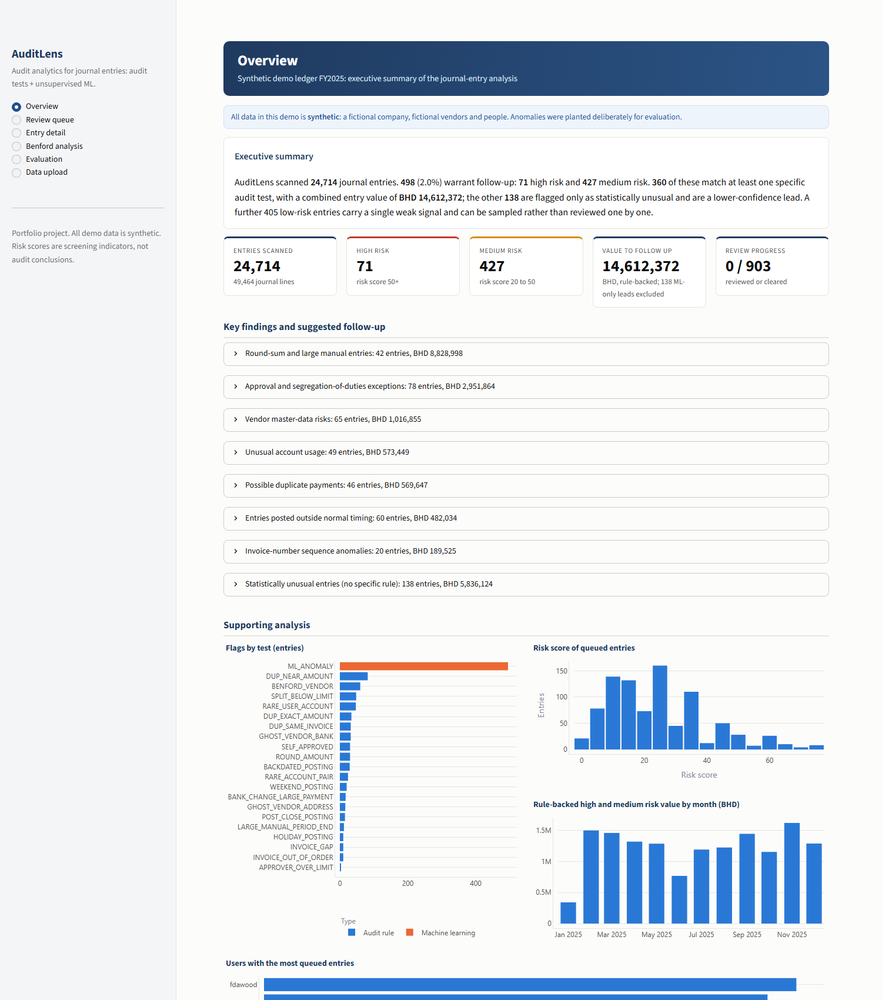
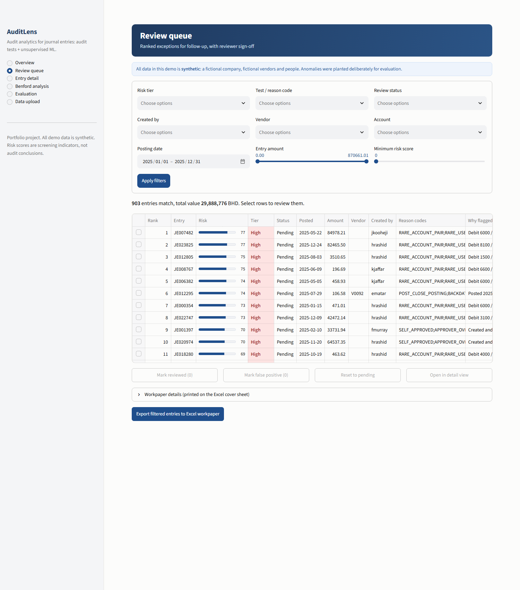
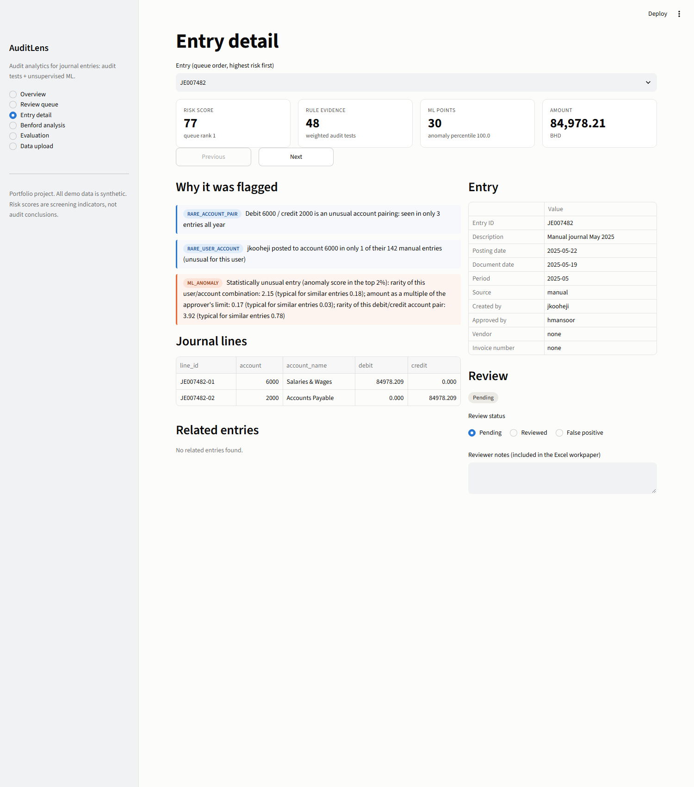
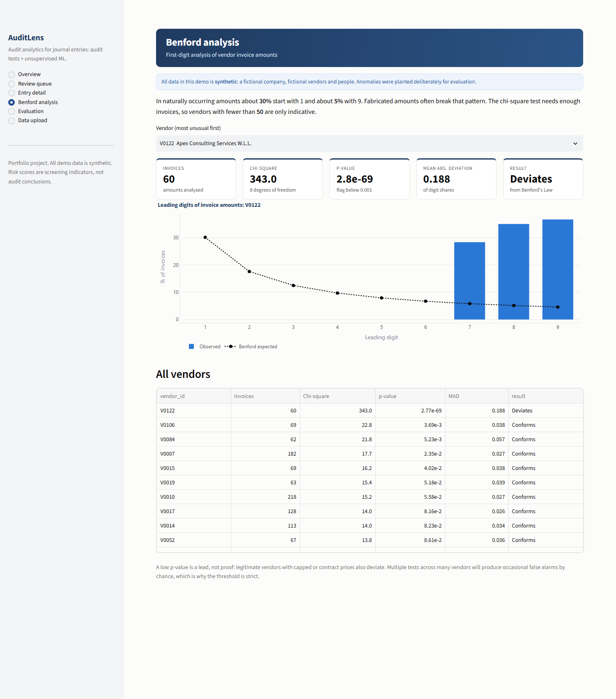

# AuditLens


**Audit analytics tool combining rule-based audit tests and unsupervised ML, evaluated against planted ground-truth anomalies.**

AuditLens scans general-ledger journal entries, flags suspicious ones the way an auditor would, explains
every flag in plain language, ranks them into a review queue, and measures how well it did against a
set of known, deliberately planted anomalies.

> **All data in this repository is synthetic.** The company, vendors, employees and users are
> fictional, and the anomalies were planted on purpose. No real client or personal data is used anywhere.

<!-- Live demo: add the Streamlit Community Cloud link here after deploying (see docs/deployment.md) -->

| | |
|---|---|
|  |  |
| *Overview: executive summary, risk tiers, findings with suggested procedures* | *Review queue: ranked, filterable, with reasons* |
|  |  |
| *Entry detail: every reason, lines, related entries* | *Benford analysis: a vendor with fabricated amounts* |

## Features

* **Synthetic ledger generator.** One fictional Bahraini company, 12 months, about 50,000 journal
  lines, reproducible from a seed. Month-end spikes, seasonal revenue (Ramadan dip, strong Q4), recurring vendor
  payments, Benford-conforming amounts, the **Bahrain calendar** (Friday/Saturday weekend, public holidays)
  and an approval hierarchy. 12 anomaly types are planted and their labels are written to a *separate* file.
* **23 explainable audit tests** in 8 families (duplicates, approvals and segregation of duties, timing,
  amounts, vendors, invoice sequences, Benford's Law per vendor, unusual account use). Every flag has a rule
  code and a readable reason. Thresholds come from `config.yaml`.
* **Unsupervised ML.** An Isolation Forest scores how unusual each entry is (no labels used), with
  plain-language explanations of what made it unusual.
* **Combined risk score and review queue.** Weighted rule evidence plus bounded ML points, ranked, with
  every entry carrying its reasons.
* **Honest evaluation.** Precision, recall and F1 per anomaly type for rules alone, ML alone and combined;
  precision at the top 50 and 100; confidence intervals; a multi-seed stability check; and a written list of
  weaknesses.
* **Streamlit dashboard.** An executive summary with High / Medium / Low risk tiers and suggested follow-up
  procedures per finding theme; a filterable review queue (filters apply together, so the page stays smooth);
  entry detail with related entries (for example the matching duplicate); a per-vendor Benford chart; an
  evaluation page; and CSV upload with column mapping and validation. Reviewers mark entries *reviewed* or
  *false positive*, add notes, and **export an Excel workpaper**.
* **Audit-style workpaper.** The Excel export has a cover sheet (entity, period, purpose, scope, procedures
  performed, legend, conclusion box, preparer and reviewer sign-off), a filterable print-ready entries sheet
  with a status drop-down, and a status summary.

## How it works

```
generate.py ──► journal_entries.csv + master data      labels.csv (separate, evaluation only)
                        │                                        │
                        ▼                                        │
      rules/ (8 families, 23 codes) ─┐                           │
                                     ├─► risk score ─► review queue ─► dashboard / Excel
      ml/ (features → Isolation      │   (noisy-OR of rule weights       │
           Forest → explanations) ───┘    + capped ML points)             ▼
                                                                  evaluate.py ◄─ labels
```

1. **Rules** return flagged entries with a code and a reason, for example *"Posted 2025-07-29 into period
   2025-06, which closed 2025-07-05"*.
2. **ML** builds about 20 features per entry (amount z-scores per account and vendor, vendor frequency,
   time features, document-to-posting lag, user/account rarity, ...) and scores them with an Isolation
   Forest. The rule signals are deliberately *not* features, so the model is an independent second opinion.
3. **Scoring** combines them: `risk = min(100, noisy-OR(rule weights) + up to 30 ML points)`. ML points only
   go to ML-flagged entries, so every queued entry has a reason.
4. **Evaluation** compares flags to the planted labels at entry level.

**New to the domain?** Start with the plain-language **[Study Guide](docs/STUDY_GUIDE.md)** (also as a printable
[HTML version](docs/STUDY_GUIDE.html)): accounting basics, how and why every part works, worked examples with the real
numbers, hands-on exercises and 30 interview questions with answers.

Full detail, including why auditors care about each test: [docs/methodology.md](docs/methodology.md).
Column-by-column description of the data: [docs/data_dictionary.md](docs/data_dictionary.md).

## Results

Run on the default synthetic dataset (24,714 entries, 412 planted anomaly entries = 1.7% of the ledger).
Full report with per-type tables, charts and caveats: [docs/evaluation_report.md](docs/evaluation_report.md).

| System | Entries flagged | Precision | Recall | F1 | Precision@50 | Precision@100 |
|---|---|---|---|---|---|---|
| Rules alone | 490 | 84.1% | 100.0% | 0.914 | 100% | 100% |
| ML alone | 495 | 13.3% | 16.0% | 0.146 | 28% | 21% |
| Combined (risk ≥ 20) | 498 | 69.9% | 84.5% | 0.765 | 100% | 100% |

Recall by anomaly type (share of planted entries flagged):

| Anomaly | Rules | ML | Combined |
|---|---|---|---|
| Duplicate payment | 100% | 0% | 92% |
| Split purchase just under a limit | 100% | 31% | 100% |
| Weekend / public-holiday posting | 100% | 0% | 100% |
| Round amount | 100% | 23% | 100% |
| Creator = approver | 100% | 17% | 100% |
| Post-close or backdated | 100% | 27% | 100% |
| Ghost vendor | 100% | 2% | 100% |
| Bank change then large payment | 100% | 12% | 100% |
| Invoice sequence gap / out of order | 100% | 0% | 100% |
| Unusual account pairing / rare user-account | 100% | 49% | 100% |
| Benford violation (one vendor) | 100% | 0% | 0% |
| Large manual entry at period end | 100% | 50% | 100% |

Across four additional datasets generated with different seeds the rules scored 84.9% ± 4.0% precision and
100% recall, ML alone 13.9% ± 2.4% / 16.7% ± 2.8%, and the combined score 71.7% ± 1.3% / 83.7% ± 1.0%.

**Stress test.** Because the main test is circular, a second adversarial ledger ([docs/challenge_report.md](docs/challenge_report.md))
plants boundary cases just outside each threshold, disguised cases, controls and legitimate look-alikes. Result: the
controls are caught 100%, but boundary cases only 3% by their intended rule (thresholds can be avoided); ML alone
catches the journals just under materiality; every legitimate look-alike reaches the queue. Run it with
`python -m auditlens.challenge_eval`.

**How to read these numbers honestly.** They flatter the system, and the report says why:

* **The test is partly circular.** I wrote both the generator and the rules, so high recall shows the rules
  are implemented correctly, not that they would catch real fraud.
* **The anomaly rate is unrealistic** (1.7% planted). At a real-world rate near 0.1%, the same rules would
  have a precision of roughly 24%.
* **ML alone is weak.** It finds statistically unusual entries only; it misses anomalies that look ordinary
  one entry at a time (a ghost vendor's invoices, a repeated payment). Its value is as a second opinion.
* **Benford is a vendor-level lead.** Its low weight puts it below the combined alert threshold, so the
  combined system misses it by design; it is surfaced on the Benford page instead.
* Several types have only 8–50 planted entries, so small differences are noise.

## Limitations

* One synthetic company and one year. No VAT, multi-currency, intercompany eliminations or complex
  reversals; vendor and approval behaviour is simplified.
* Weights and thresholds are judgement calls from audit practice, not tuned on held-out data. (The
  near-duplicate tolerance was tightened after a first run, which the report discloses.)
* The risk score is a screening aid. Every flag needs auditor judgement and evidence before it becomes a finding.
* Ground truth exists only for the synthetic data, so the Evaluation page is unavailable for uploaded files.
* The demo is not built for confidential data. Do not upload client data to a public deployment.

## What I would build next

* Adapters for real ERP exports (SAP, Oracle) and a mapping profile per client.
* Fuzzy matching for ghost vendors (names, addresses, phone numbers), not only exact bank and address matches.
* A feedback loop: use reviewers' *reviewed / false positive* decisions to re-weight rules and train a
  supervised model, with a held-out period to measure improvement honestly.
* Per-user behavioural baselines (typical hours, accounts, amounts) and SHAP-style explanations.
* VAT, multi-currency and intercompany logic, plus sampling support (statistical and judgemental).
* An audit trail of reviewer decisions, scheduled runs, and export to the firm's working-paper format.

## Run locally (Windows, Command Prompt)

Requires Python 3.13 (`py -3.13 --version`).

```bat
git clone https://github.com/Vivan-coder/auditlens.git
cd auditlens
py -3.13 -m venv .venv
.venv\Scripts\activate
pip install -r requirements.txt
pip install -e .

python -m auditlens.generate     :: writes data\*.csv (about 10 seconds)
python -m auditlens.pipeline     :: optional: writes outputs\review_queue.csv
python -m auditlens.evaluate     :: report and charts in outputs\ (about 30 seconds)
streamlit run app.py             :: opens the dashboard
```

If `data\` has not been generated, the dashboard generates the demo ledger in memory on first load.

| Task | Command |
|---|---|
| Run the app | `streamlit run app.py` |
| Generate data | `python -m auditlens.generate` (`--seed 7`, `--lines 20000`) |
| Evaluate | `python -m auditlens.evaluate` (`--no-stability` for a quick run, `--publish-docs` to refresh `docs/`) |
| Test | `pytest` |
| Lint | `ruff check .` |

GitHub Actions runs `ruff check .` and `pytest` on every push. Deployment to Streamlit Community Cloud:
[docs/deployment.md](docs/deployment.md).

## Project layout

```
app.py                     Streamlit entry point
config.yaml                every threshold, approval limit, weight and anomaly count
dashboard/                 one module per page + state and styling
src/auditlens/
  generate.py, synth/      synthetic ledger and anomaly injectors
  rules/                   one module per audit-test family
  ml/                      features, Isolation Forest, risk score
  pipeline.py              rules + ML + queue in one call
  evaluate.py              metrics against labels.csv (+ eval_report.py, eval_charts.py)
  challenge.py             adversarial challenge ledger (+ challenge_eval.py report)
  schema.py, export.py     CSV validation (pydantic) and Excel workpaper (openpyxl)
docs/                      data dictionary, methodology, evaluation report, deployment notes
tests/                     162 pytest tests (generator, every rule, scoring, evaluation, validator, challenge set, app pages)
scripts/                   optional developer tools (build the HTML study guide)
```

## Tech

Python 3.13, pandas, NumPy, SciPy, scikit-learn, Faker, Streamlit, Plotly, openpyxl, pydantic, pytest, ruff.
No paid services or APIs.
