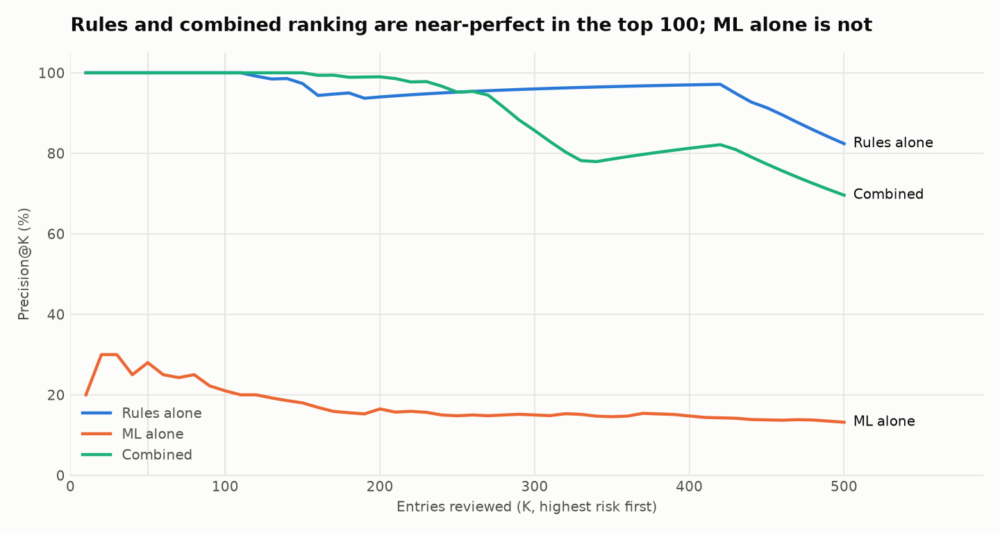
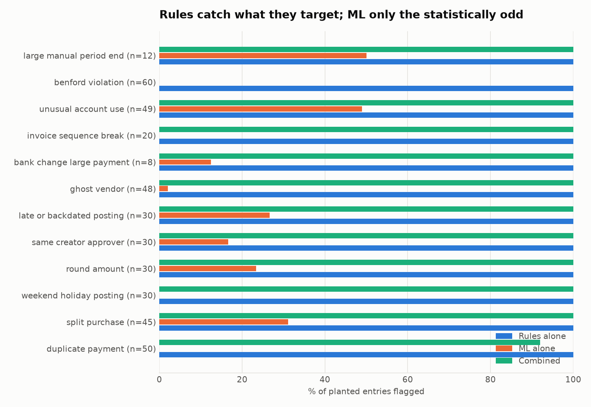
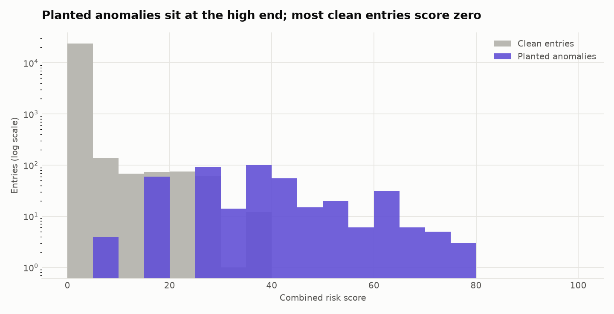

# AuditLens evaluation report

All data is synthetic. Ground truth comes from the separate `labels.csv`; it was never used as a
feature or by any rule. Unit of analysis: one journal entry.

**Dataset:** 24,714 entries, 412 planted anomaly entries
(1.7% of the ledger).

## Overall results

| System | Entries flagged | True positives | Precision (95% CI) | Recall (95% CI) | F1 | Share of ledger flagged |
|---|---|---|---|---|---|---|
| Rules alone | 490 | 412 | 84.1% (81%-87%) | 100.0% (99%-100%) | 0.914 | 1.98% |
| ML alone | 495 | 66 | 13.3% (11%-17%) | 16.0% (13%-20%) | 0.146 | 2.00% |
| Combined | 498 | 348 | 69.9% (66%-74%) | 84.5% (81%-88%) | 0.765 | 2.02% |

* **Rules alone** = any audit test fired. **ML alone** = Isolation Forest score in the top
  2%. **Combined** = risk score >= 20
  (a specific rule hit, or a very unusual entry, or several weak signals together).
* Intervals are 95% Wilson intervals for the proportions.

## Auditor capacity: precision at the top of the queue

| System | Precision@50 | Precision@100 | Recall@50 | Recall@100 |
|---|---|---|---|---|
| Rules alone | 100% | 100% | 12% | 24% |
| ML alone | 28% | 21% | 3% | 5% |
| Combined | 100% | 100% | 12% | 24% |

If reviewers can only look at the top K entries, this is what they would find. Recall@K is capped by
how many anomalies exist (K / 412 at best).

## Per anomaly type

| Anomaly type | n | Rules alone P | R | F1 | ML alone P | R | F1 | Combined P | R | F1 |
|---|---|---|---|---|---|---|---|---|---|---|
| duplicate payment | 50 | 43% | 100% | 0.60 | 0% | 0% | 0.00 | 100% | 92% | 0.96 |
| split purchase | 45 | 94% | 100% | 0.97 | 3% | 31% | 0.05 | 94% | 100% | 0.97 |
| weekend holiday posting | 30 | 100% | 100% | 1.00 | 0% | 0% | 0.00 | 100% | 100% | 1.00 |
| round amount | 30 | 100% | 100% | 1.00 | 1% | 23% | 0.03 | 100% | 100% | 1.00 |
| same creator approver | 30 | 100% | 100% | 1.00 | 1% | 17% | 0.02 | 100% | 100% | 1.00 |
| late or backdated posting | 30 | 100% | 100% | 1.00 | 2% | 27% | 0.03 | 100% | 100% | 1.00 |
| ghost vendor | 48 | 100% | 100% | 1.00 | 0% | 2% | 0.00 | 100% | 100% | 1.00 |
| bank change large payment | 8 | 47% | 100% | 0.64 | 0% | 12% | 0.00 | 47% | 100% | 0.64 |
| invoice sequence break | 20 | 100% | 100% | 1.00 | 0% | 0% | 0.00 | 100% | 100% | 1.00 |
| unusual account use | 49 | 100% | 100% | 1.00 | 5% | 49% | 0.09 | 100% | 100% | 1.00 |
| benford violation | 60 | 100% | 100% | 1.00 | 0% | 0% | 0.00 | 0% | 0% | 0.00 |
| large manual period end | 12 | 100% | 100% | 1.00 | 1% | 50% | 0.02 | 100% | 100% | 1.00 |

How to read it: *R* is the share of that type's planted entries the system flagged at all. *P* for
Rules and Combined counts only entries carrying a rule designed for that type. ML has no designed
type, so its *P* is its yield: the share of all ML flags that are this type. *F1* is derived from
the two.

## Choosing the alert threshold

The threshold of 20 was set in advance from the scoring design (a single specific rule
passes it; a single weak rule, such as a near-duplicate amount, does not). It was not tuned
afterwards. Moving it trades precision for recall:

| Risk threshold | Entries flagged | Precision | Recall | F1 |
|---|---|---|---|---|
| 1 | 903 | 45.6% | 100.0% | 0.627 |
| 10 | 700 | 58.3% | 99.0% | 0.734 |
| 20 (used) | 498 | 69.9% | 84.5% | 0.765 |
| 30 | 268 | 95.1% | 61.9% | 0.750 |
| 40 | 141 | 100.0% | 34.2% | 0.510 |
| 50 | 71 | 100.0% | 17.2% | 0.294 |
| 60 | 45 | 100.0% | 10.9% | 0.197 |

## Where the false positives come from

| Flag source | Entries flagged | Of which clean | Precision |
|---|---|---|---|
| `ML_ANOMALY` | 495 | 429 | 13% |
| `DUP_NEAR_AMOUNT` | 82 | 66 | 20% |
| `BANK_CHANGE_LARGE_PAYMENT` | 17 | 9 | 47% |
| `SPLIT_BELOW_LIMIT` | 48 | 3 | 94% |
| `APPROVER_OVER_LIMIT` | 3 | 0 | 100% |
| `DUP_EXACT_AMOUNT` | 34 | 0 | 100% |
| `BENFORD_VENDOR` | 60 | 0 | 100% |
| `BACKDATED_POSTING` | 29 | 0 | 100% |

## Stability across random seeds

Each of 4 extra datasets was generated with a different seed and analysed with the same settings (mean +/- standard deviation across seeds):

| System | Precision | Recall | F1 | Precision@100 |
|---|---|---|---|---|
| Rules alone | 84.9% +/- 4.0% | 100.0% +/- 0.0% | 91.8% +/- 2.3% | 100.0% +/- 0.0% |
| ML alone | 13.9% +/- 2.4% | 16.7% +/- 2.8% | 15.2% +/- 2.6% | 24.5% +/- 5.1% |
| Combined | 71.7% +/- 1.3% | 83.7% +/- 1.0% | 77.2% +/- 0.9% | 100.0% +/- 0.0% |

## Weaknesses and caveats

1. **The test is partly circular.** I wrote the generator and the rules, and each rule implements the same definition as the anomaly it targets. Recall close to 100% for the rules shows the implementation works, not how it would perform on a real ledger, where frauds are less tidy and are not labelled.
2. **The anomaly rate is unrealistic.** 1.7% of entries are planted anomalies. At a real-world rate of 0.1% the same rules (recall 100%, false-positive rate 0.32% of clean entries) would have a precision of about 24%; most of the queue would be false alarms. Precision numbers here are therefore optimistic.
3. **ML alone is weak as a detector.** It flags 495 entries with 13.3% precision, and finds under 10% of: duplicate payment, weekend holiday posting, ghost vendor, invoice sequence break, benford violation. Many audit anomalies are not statistically unusual entry by entry (a ghost vendor's invoices look like any other invoice). Its value is as a second opinion that surfaces odd entries no rule describes.
4. **Near-duplicate amounts are mostly noise.** `DUP_NEAR_AMOUNT` flags 82 entries but only 20% are planted; coincidences between genuinely different invoices are common among large vendors. It is given a low weight and only matters alongside other evidence.
5. **Some types are under-served at the alert threshold.** The combined system (risk >= 20) surfaces under half of: benford violation. Benford is a vendor-level lead that implicates every invoice of a vendor, so it carries a low weight; it belongs on the Benford page as one lead per vendor rather than in the entry queue.
6. **Single synthetic company, one year.** Seasonality, vendor behaviour and approval patterns are simplified (no VAT, no multi-currency, no intercompany, no reversals other than accruals). Thresholds were chosen by reasoning about audit practice, but I did inspect this dataset while building: after a first run showed many coincidental matches I tightened the near-duplicate tolerance (1% to 0.5%) and split duplicates into exact and near codes. Nothing was tuned on held-out data; the multi-seed table above is the check that the settings are not specific to one random draw.
7. **Per-type numbers rest on small counts.** Several types have 8-30 planted entries, so a single missed entry moves recall by several points. Treat differences of a few points between systems as noise.
8. **Planted anomalies are isolated.** Each planted entry breaks one rule and is otherwise ordinary. Real misstatements tend to be disguised and may break several controls at once or none that a rule can see.
